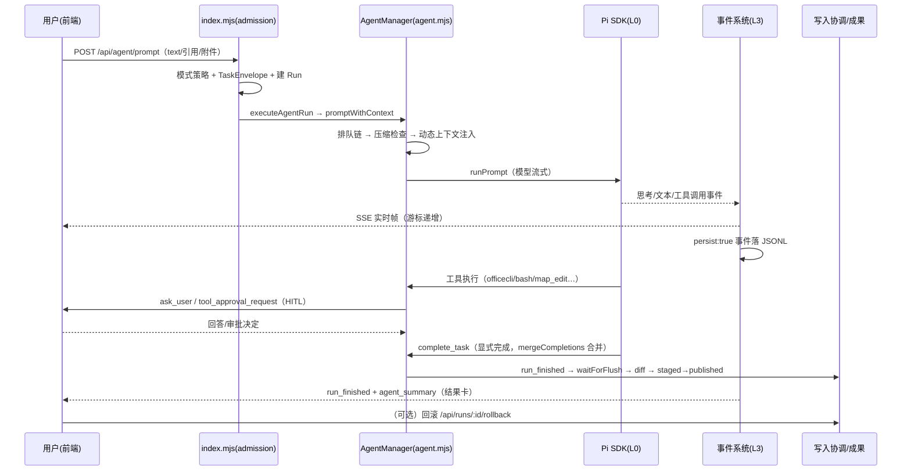

# Open Plan 系统架构文档

> 基线版本 v0.11.55（2026-10-20）。本文回答"系统由什么组成、怎么拼、数据怎么流"。
> 目标层见 `docs/2026-10-20-产品设计与业务目标总览.md`；决策依据见 `docs/2026-10-20-技术决策记录.md`。

## 一、技术栈与运行形态

- **运行形态**：Express 5 单服务（默认 `127.0.0.1:3002`）+ React 18 SPA（Vite 5 构建）+ Pi Agent SDK 1.1.0 **进程内调用** + officecli 外部二进制
- **运行时**：Node.js ≥ 22（`node:sqlite`、原生 test runner 可用）
- **服务守护**：`scripts/服务监督.mjs` 健康检查 + 崩溃自动重启（冷启动宽限 180s）
- **持久化**：全部本地文件（无数据库服务）；运行数据在 `.oaw/`（已 gitignore）
- **关键依赖**（零新增原则下复用）：`xlsx`（SheetJS）、`docx`、`docx-preview`、`x-data-spreadsheet`、`pptxviewjs`、`@antv/g6`、maplibre-gl、typebox（Pi 已带）

## 二、分层架构（L0–L4）

```
L4 前端（React SPA，client/src）
  App.jsx（页签/画布/路由） · ChatPanel（对话流） · DocViewer 家族（预览）
  MapPanel（GIS） · KnowledgeBase · SessionSidebar · SettingsPanel · 对象栏/工作流启动器
        ↑ SSE（事件协议 v2：游标/代际/心跳/背压）        ↓ REST /api/*
L3 流与事件层（server）
  流连接.mjs（连接预算/配额） · 事件协议.mjs · 事件存储.mjs（JSONL 落盘） · 事件注册表.mjs（130+ 类型）
L2 治理层（server，业务逻辑）
  agent.mjs（AgentManager：会话/Run/工具/HITL） · index.mjs（REST+admission+executeAgentRun）
  runs/写入协调/成果管理（产物生命周期） · 审批策略 · 运行预算 · 子代理编排器 · 编辑流水线
  task.mjs（模式与工具白名单） · 运行开关.mjs（flag 管道） · 工作流注册表/工作流校验（领域 Harness）
L1 适配层（薄壳）
  office.mjs/officecli（文档二进制） · Pi运行时管理.mjs（SDK 生命周期） · mcp管理.mjs
  内置浏览器.mjs（CDP） · 空间分析.mjs · 地图*（GIS 引擎） · kb.mjs（知识索引） · 文档引擎.mjs
L0 Pi Agent SDK 内核（不改）：createAgentSession / ModelRuntime / setThinkingLevel
```

设计意图：**L0 不动、L1 薄壳、L2 全部业务逻辑、L3 是唯一事实通道、L4 只做投影**。

## 三、核心子系统

### 3.1 Agent 会话与 Run 生命周期（agent.mjs + index.mjs）

- 会话键 `agentKey(clientId:threadId)`；`AgentManager.sessions` 持有 entry（busy/activeRunId/queuedCount/pendingCompletion…）
- 发送链路：`POST /api/agent/prompt` → admission（模式策略/引用登记）→ `executeAgentRun` → `promptWithContext` → `_enqueuePrompt`（promptChain 串行队列 + 压缩检查）→ `_promptEntry`（动态上下文注入 + TaskEnvelope 摘要）
- 竞态保护：busy 看门狗（`OAW_BUSY_WATCHDOG`）、SESSION_BUSY 快照、首事件超时（45s）与流静默超时（120s）
- 中断：abort 路径 + P0-3 排空语义（`run_draining`，flag 门控）

### 3.2 事件系统（唯一事实来源）

```
Pi SDK 事件 → 规范化 → 事件注册表校验（schema 可选，eventSchemaCheck 开启时告警不阻断）
  → emitChannel/emitChannelSafe：SSE 广播 + persist:true 的事件写 JSONL
  → .oaw/events/事件流.jsonl（全局） 与 .oaw/runs/<runId>/（Run 视角）
  → 前端按游标回放（断线补齐、跨会话恢复）
```

- 注册表双标记：`lifecycle`（生命周期）与 `persist`（落盘）；未登记类型 = 不落盘、`test:pi-iteration` 失败
- 前端投影：`运行展示投影.js`（Run 视图：状态/等待原因/工作阶段/产物/答案）、`运行轨迹.mjs`（工具聚合/完成语义）、`事件展示.js`（文案与图标）
- 当前注册类型 117+（生命周期 111 / 落盘 104 / 增量 6）

### 3.3 HITL：提问与审批

- **ask_user**：工具阻塞等待，`pendingAsks` Map（live）+ `.oaw/pending-asks.json`（持久化）；窗口 60 分钟；超时发 `ask_expired`；回答发 `ask_answered`（mode=live/queued_resume/resumed）；迟到回答自动续跑（`askAutoResume` 默认开：忙=排队接力，空闲=新 Run）
- **工具审批**：opencode 式三值（allow/always/deny），`审批策略.mjs` 作用域规则 + 5 分钟超时视为拒绝；请求载荷可带 owner（P1-4，flag 门控）
- 取消中的 Run 不复活：isRunStopping 优先于一切续跑

### 3.4 产物生命周期（写入协调 → 成果管理）

```
Agent 写盘 → snapshotWorkspace 快照 diff → waitForFlush 稳定 → filterRunChanges（排除其他 Run 暂存）
  → staged 暂存（stagedVisible 开=运行中可见）→ run_finished 时 publishPaths 发布
  → .oaw/runs/<runId>/写入清单.json（path/status/writes/size/publishedAt）
  → 前端「本轮产物」tab（attributed/confirmed 分级） + 回滚（/api/runs/:id/rollback）
```

### 3.5 运行开关管道（评审 R8）

- 唯一入口 `server/运行开关.mjs`：env 解析 + 默认值 + 只读快照；业务模块禁直读 process.env
- 下发：`/api/status` → `runtimeFlags`；前端 `client/src/运行开关.js` 只读消费（`flag()/numberFlag()`，**快照未达 = 全关 = 基线行为**）
- 语义：默认关 = 历史基线；`readFlagWithDefault` 仅用于用户批准默认开的能力（askAutoResume/stagedVisible/autoTab）
- 当前开关族：Pi 扩展（U2-U10）、交互优化（P1-P2）、会话恢复（A2-A4）、GIS（G1-G12）、Qoder 对标（12 个 qoder*）、任务编排（askTimeoutMs/askAutoResume）

### 3.6 GIS 子系统（B4）

- 项目体系：`office-workspace/maps/{project}/`（map.config.json + style.json + layers/*.geojson + 瓦片索引）；默认项目 zhejiang-map
- 能力分级：Chat 只读四件套（map_read/map_analyze/map_clear_analysis/map_datasets）；Work 增加 map_edit/map_import/map_save_analysis（写操作走审批）
- 分析：map_analyze（heatmap/od/isochrone 演示 + buffer/spatial_filter/bbox_clip 真实空间算子，`OAW_SPATIAL_ANALYSIS`）+ 数据源适配器（local-file/live-traffic-api/sql-database，flag 门控）
- 交付：G8 报告成文（docx 直写）、G7 批量导出（专用浏览器会话出图）、G9 项目打包 zip、G5 场景模板
- 专项路线图见根目录 `后续开发计划.md`（M2-M6）

### 3.7 预览链路（DocViewer 家族）

```
打开文件 → GET /api/doc/:name?cwd= → kind 分流（docx/xlsx/pptx/pdf/md/html/image/text）
  → 预览响应带 identity（cwd+revision），前端 identityMatches 校验防串
docx  → DocxViewer：docx-preview renderAsync（分页/批注/修订）+ repaginateDocx 二次分页
        + 二进制 LRU 缓存（3×25MB）+ 缺失中文字体回退注入 + 适应宽度缩放
xlsx  → ExcelGrid：x-data-spreadsheet 可编辑；服务端 SheetJS 直读优先（显示值/合并单元格/列宽/
        0-based 键/5000 行×120 列×30 表截断），officecli 兜底；保存走 /api/doc/:name/cells
pptx  → PptxViewer（Canvas 翻页）  pdf → iframe 原生  md/txt/csv/json → MarkdownBody
```

### 3.8 会话恢复与重建（A 系列）

- 冷启动：`runs/` 中断前活动 Run 标记 recovering；`OAW_REPLAY_RECOVER` 开启时首连探测 LIVE Run + 从 Run 起点整段回放（上限 4000 条）
- queued 状态的用户回答：服务重启后经 `consumeRecoveredAnswers` 在下一次 prompt 注入

## 四、总体数据流（一次 Work 任务）



## 五、目录导览

```
server/               L2/L3/L1 全部服务端模块（中文命名）
client/src/           React SPA（组件/投影/开关/外观）
  components/         ChatPanel·DocViewer·DocxViewer·ExcelGrid·PptxViewer·MapPanel·KnowledgeBase…
  运行开关.js           前端只读 flag 消费端
  运行展示投影.js       Run 事件 → 视图投影
scripts/              68+ test:* 回归脚本、构建与运维脚本
docs/                 设计/方案/验证报告（本文档所在）
docs/plans/           编号执行计划（001-019…）
.oaw/                 运行数据（runs/、events/、pending-asks.json）——不入库不入 Git
office-workspace/     默认工作区（用户文件 + maps/ 地图项目）
memory/               Agent 长期记忆（建议确认后写入）
```

## 六、质量门禁

- `npm run verify`（语法 + Vite 构建 + API 冒烟）通过才提交；提交信息 `类型: 描述`
- 68+ `test:*` 回归脚本；关键守护：事件注册表（未登记事件必失败）、Icon 引用断言、动效治理（styles.css 动效闸门）、组件交互规范（§3.3）、事件负载 schema
- E2E：GIS 交付端到端（真实浏览器出图）、批量导出 16 例、对话流性能回归
